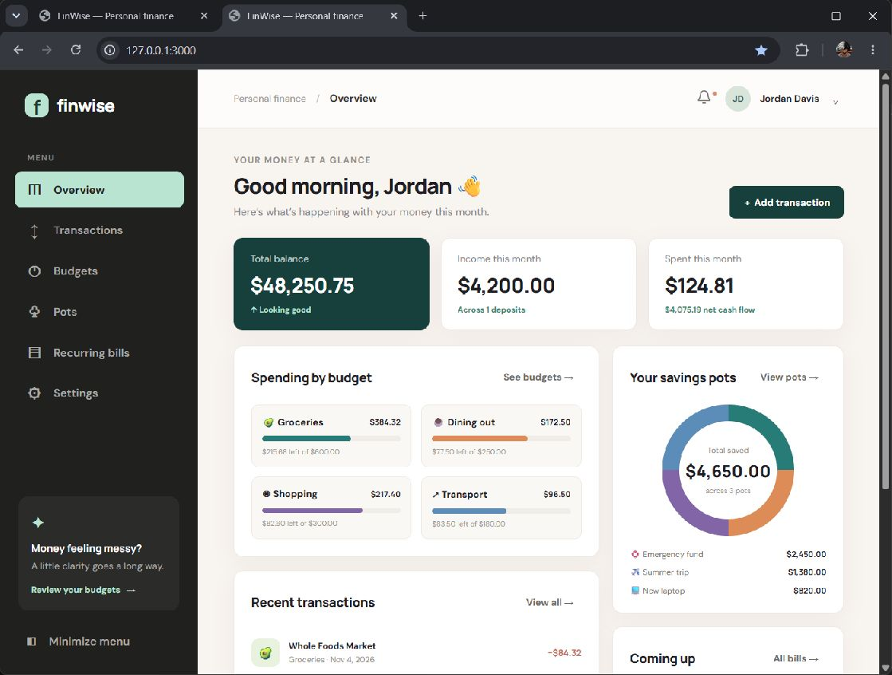
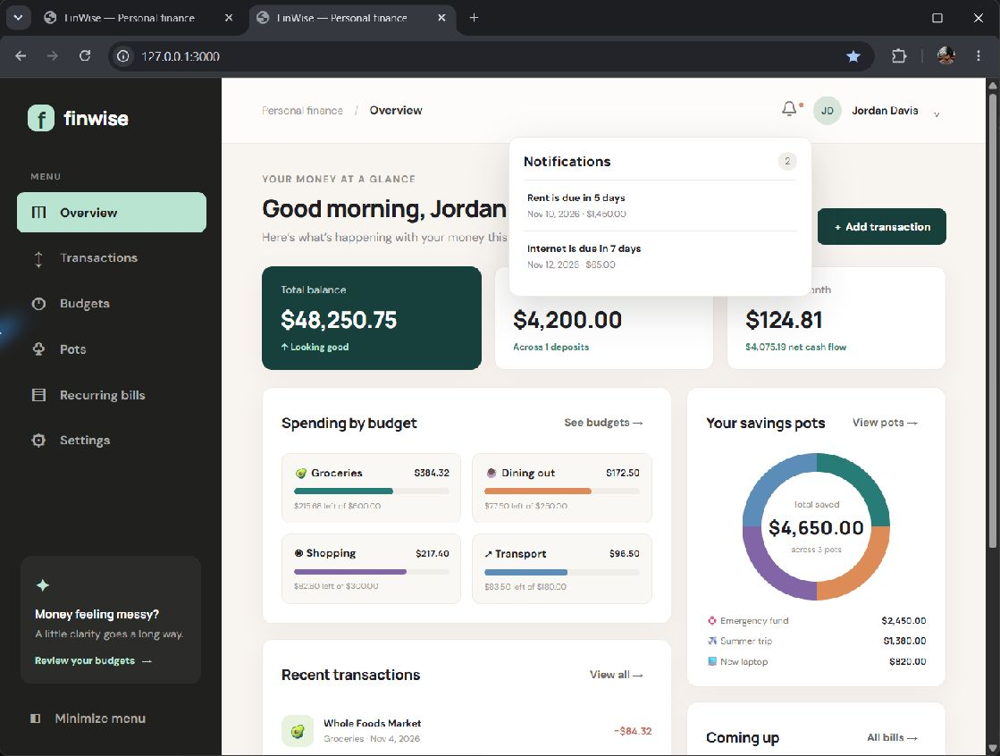

# FinWise

FinWise is a personal finance tracker with a free hosted preview and a local account-enabled version.

## Open the hosted preview

Visit <https://otaku-ace-coder.github.io/finwise-personal-finance/> on a computer or phone. In the hosted preview, changes are saved in that browser only. Sign-up and account sync are available in the local version below.

## Preview

### Dashboard

### Notifications

## Start the app

1. Install Node.js 24 or newer.
2. Open a terminal in this folder.
3. Run `npm start`.
4. Open `http://localhost:3000` in your browser.

## Phone preview

For a preview on a phone connected to the same Wi-Fi, run `npm run preview:phone`. Find this computer's IPv4 address with `ipconfig`, then open `http://<computer-ip>:3000` on the phone. Phone preview mode disables sign-up, sign-in, and account APIs; it only serves the app and sample data.

The app has no external package dependencies. It serves the web pages and handles account sign-up and sign-in from `server.js`.

## How the files fit together

- `index.html` is the page frame and navigation.
- `styles.css` controls the colors, layout, and small-screen view.
- `app.js` draws each screen, handles buttons, and saves changes.
- `server.js` serves the app, checks sign-up and sign-in, hashes passwords, and stores each account's finance data separately.
- `.finwise/users.json` is created on this computer when the first account is registered. It is excluded from Git.

Settings include currency display, a light/dark theme, and a profile photo. Photos are resized in the browser before they are saved with the account.

Passwords are never saved in the browser. The server stores a one-way password hash. Sign-in sessions last until the server restarts or the cookie expires.

The GitHub Pages version serves only the static demo files. Account data and passwords are not collected by that hosted preview.
